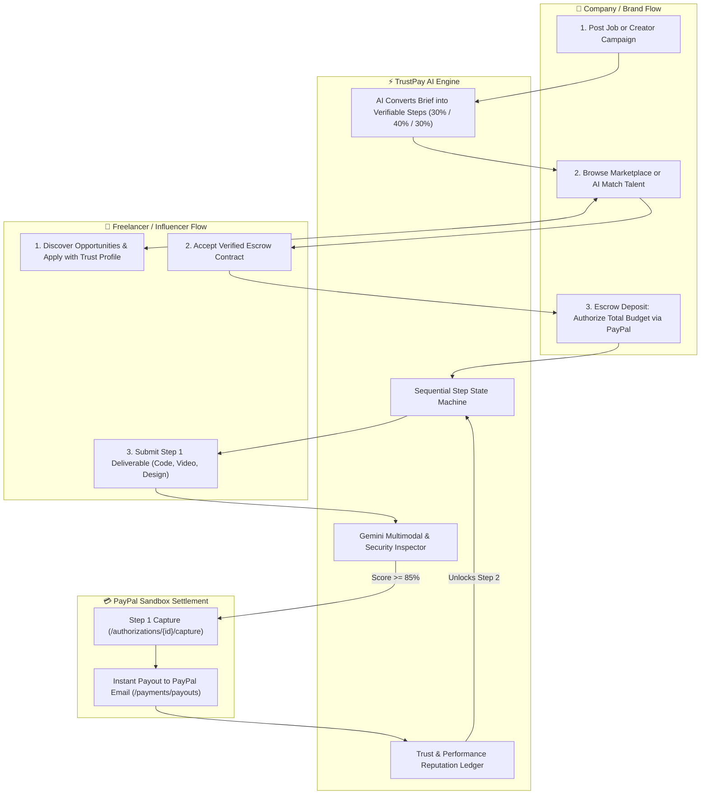

# 🌐 TrustPay AI: The Autonomous Escrow Marketplace
> **A Two-Sided AI-Powered Marketplace Bridging Companies with Freelancers & Creators — Featuring Step-by-Step (Partwise) Milestone Escrow, Multimodal Verification, Security Scanning, and Proof-of-Work Reputation Powered by PayPal & Gemini AI.**

---

## 1. Executive Summary & Marketplace Vision

### What is TrustPay AI?
TrustPay AI is a **two-sided marketplace** that connects **Companies/Brands** with **Freelancers (Developers, Designers, Writers)** and **Influencers/Creators (Instagram, TikTok, YouTube, X)**.

Unlike traditional gig platforms (Upwork, Fiverr) that charge massive fees (up to 20%), rely on subjective dispute support that takes weeks, and offer all-or-nothing payments:
- **Companies** get guaranteed quality: funds are only disbursed when concrete requirements and security standards are objectively verified by AI.
- **Freelancers & Influencers** get guaranteed payment: money is locked in PayPal escrow upfront and released **step-by-step (partwise)** as milestones complete, eliminating client ghosting and scope creep.
- **The Marketplace Bridge:** Smart AI matching connects company briefs directly with top-rated talent based on objective, verified track records.

---

## 2. Core Marketplace Architecture & User Flows



---

## 3. Complete Feature Breakdown

### 🛒 1. The Two-Sided Marketplace Experience
* **Company / Brand Portal:**
  - Post software gigs (web, mobile, backend) or influencer campaigns (sponsored videos, product reviews).
  - Define campaign criteria (e.g., target reach, required hashtags `#ad`, coupon codes, code testing specs).
  - Search talent filtered by verified stats (e.g., `>95% on-time rate`, `Grade A security record`).
  - Single-click PayPal Escrow funding for entire projects.
* **Freelancer & Influencer Portal:**
  - Marketplace feed with transparent budgets, step milestones, and acceptance criteria.
  - Apply with one click using their verified **Trust & Performance Scorecard**.
  - Secure escrow badge gives 100% confidence they won't get ghosted.
* **AI Matchmaker (Company $\leftrightarrow$ Talent Bridge):**
  - Company pastes a project prompt; Gemini AI analyzes past delivery records and recommends the top 3 best-fit freelancers or influencers.

---

### 💰 2. Step-by-Step (Partwise) Milestone Escrow
* **Total Budget Authorization:**
  - Company authorizes the full project budget (e.g., $1,200) via PayPal (`intent: AUTHORIZE`). Money remains in escrow.
* **Sequential Step Execution:**
  - **Step 1 (30% – $360):** Kickoff & core spec / initial draft.
  - **Step 2 (40% – $480):** Main implementation / final video production.
  - **Step 3 (30% – $360):** Quality assurance / live publication & engagement verification.
* **Autonomous Step Release:**
  - Freelancer submits deliverable for Step $N$.
  - AI scores fulfillment ($0\text{--}100\%$).
  - When verified, system calls `/v2/payments/authorizations/{id}/capture` for **only that step's amount** and immediately triggers PayPal Payouts to the talent's PayPal email.
  - Step $N+1$ automatically unlocks.
* **Pro-Rated Settlement (Partial Delivery):**
  - If deliverable is mostly complete (e.g. 75% score), AI proposes an instant partial payout ($75\%$) and a 48h punch-list for the remaining $25\%$.
* **Anti-Ghosting Auto-Release:**
  - If deliverable scores $\ge 90\%$ and the company remains inactive for 72 hours, escrow auto-captures and pays the creator.

---

### 🎥 3. Influencer & Sponsored Campaign Verification
* **Multimodal Audio/Video Inspection:**
  - Creator submits draft or live social post URL (Instagram, TikTok, YouTube, X).
  - Gemini scans visual video frames + transcribes audio:
    - **FTC/Legal Disclosure:** Confirms `#ad`, `#sponsored`, or "Paid Partnership" tag is visible in caption/video.
    - **Audio Script Adherence:** Checks if mandatory talking points and unique discount code (e.g., `SAVE30`) were verbalized.
    - **Visual Placement:** Confirms product/logo appears on screen for the agreed minimum duration.
* **Anti-Delete & Retention Check:**
  - Automated ping ensures the sponsored post remains live for the agreed contract duration (preventing influencers from deleting posts 24h later).

---

### 🛡️ 4. Security & Anti-Fraud Suite
* **Code Security & Leak Inspection:**
  - Scans code submissions for hardcoded API keys, JWT secrets, database passwords, and known vulnerable packages before releasing payments.
* **Bot & Fake Engagement Detection:**
  - Evaluates influencer engagement patterns (comment-to-like ratios, bot cluster anomalies) to ensure companies get real human audiences.
* **PayPal Cryptographic Webhook Security:**
  - Validates PayPal transmission signatures (`PAYPAL-TRANSMISSION-SIG`) to block spoofed payment triggers.
* **Dual-Custody Protection:**
  - Company cannot pull funds back once work is under review; talent cannot withdraw without verified delivery proof.

---

### 📊 5. Trust & Performance Scorecard (Ratings & Metrics Engine)
Objective, algorithmic reputation calculated from real transaction data:
* **For Freelancers & Influencers:**
  - **Spec Compliance Rate:** (e.g., `97%` average first-pass compliance).
  - **On-Time Delivery Rate:** (e.g., `98%` milestones met on schedule).
  - **Security & Quality Grade:** (`Grade A` – 0 leaked credentials, clean test coverage).
  - **Audience Authenticity Score:** (`94% real human followers`).
  - **Verified Badges:** *"Verified Creator"*, *"Clean Code Certified"*, *"Top 5% Timeliness"*.
* **For Companies & Brands:**
  - **Escrow Reliability:** 100% funded authorizations.
  - **Median Review Latency:** Fast approval turnaround time.
  - **Dispute Ratio:** Flags problematic or non-responsive brands.

---

## 4. Beginner-Friendly Technology Stack

| Layer | Recommended Choice | Purpose |
| :--- | :--- | :--- |
| **Frontend** | **Next.js 14 (React) + Tailwind CSS + Lucide Icons + AG Grid** | Dual marketplace portals (Company & Talent), step-by-step milestone visualizer, deliverable dropzone, AI audit modals. |
| **Backend** | **Python (FastAPI)** | Clean REST endpoints, asynchronous execution, auto-generated interactive API docs at `http://localhost:8000/docs`. |
| **Database** | **SQLite (via SQLAlchemy)** | Zero-setup, lightweight database storing Marketplace Listings, Contracts, Step Milestones, and Metric Profiles. |
| **AI Engine** | **Google Gemini 2.5/Flash (`google-genai` Python SDK)** | Multimodal media analysis, code vulnerability inspection, audio transcript verification, score generation. |
| **Payment Engine** | **PayPal Sandbox REST API v2** | Escrow Order Authorizations, Partwise Captures, Payouts API, and Refunds. |
| **Hosting** | **Render (Backend) & Vercel (Frontend)** | Fulfills hackathon live hosted demo requirements. |

---

## 5. Work Division for the Team

```
                         ┌───────────────────────────────────────┐
                         │              TrustPay AI              │
                         │         Marketplace Platform          │
                         └───────────────────────────────────────┘
                                     │               │
                 ┌───────────────────┴──────┐ ┌──────┴────────────────────┐
                 │                          │ │                           │
         ┌───────────────┐          ┌───────────────┐             ┌───────────────┐
         │ Vachan        │          │ Devansh (You) │             │ Advika        │
         │ Frontend Lead │          │ PayPal Engine │             │ AI Verifier & │
         │ & Marketplace │          │ & Partwise    │             │ Security Lead │
         │ UI            │          │ Escrow Lead   │             │               │
         └───────────────┘          └───────────────┘             └───────────────┘
                 │                          │                             │
                 └──────────────────┬───────┴─────────────────────────────┘
                                    │
                            ┌───────────────┐
                            │ Tanisha       │
                            │ Backend Core, │
                            │ Marketplace DB│
                            │ & Glue Lead   │
                            └───────────────┘
```

### 👤 Vachan — Frontend & Marketplace UI Lead
* **Git Branch:** `feature/frontend`
* **Directory:** `/frontend`
* **What to build:**
  1. **Dual Marketplace UI:** Company Portal (post gigs/campaigns, fund escrow) vs. Talent Portal (browse gigs, submit deliverables).
  2. **Step-by-Step Milestone Visualizer:** Clean progress bar showing Step 1 (Paid) $\rightarrow$ Step 2 (In Review) $\rightarrow$ Step 3 (Locked).
  3. **Deliverable Upload Dropzone & AI Audit Modal:** File dropzone and pop-up modal showing AI checklist ticks, fulfillment score (e.g., 94%), and security grade.
  4. **Trust & Performance Scorecards:** Visual cards displaying badges, compliance percentages, and on-time ratings.

---

### 👤 Devansh (You) — PayPal Engine & Partwise Escrow Lead
* **Git Branch:** `devansh` / `feature/paypal`
* **Directory:** `/backend/app/services/paypal_service.py` & `/backend/app/api/paypal_routes.py`
* **What to build:**
  1. **PayPal Sandbox Setup:** Create Developer sandbox accounts (1 Business for Company, 1 Personal for Talent) and obtain `CLIENT_ID` & `CLIENT_SECRET`.
  2. **Escrow Authorization (`intent: AUTHORIZE`):** Endpoint to lock the full contract budget into escrow upfront.
  3. **Step-by-Step (Partwise) Capture:** Endpoint to call `/v2/payments/authorizations/{auth_id}/capture` for the specific dollar amount of that step when AI approves.
  4. **Instant Payouts API:** Disburse captured money directly to the freelancer/influencer's PayPal email using `/v1/payments/payouts`.
  5. **Refunds & Webhook Security:** Endpoint for dispute refunds and signature verification.

---

### 👤 Advika — AI Multimodal Verifier & Security Lead
* **Git Branch:** `feature/ai`
* **Directory:** `/backend/app/services/ai_service.py` & `/backend/app/api/ai_routes.py`
* **What to build:**
  1. **Milestone Spec Decomposer:** Accepts a job prompt and converts it into structured JSON steps with percentage weights and validation criteria.
  2. **Code & Technical Deliverable Evaluator:** Evaluates code against specs and scans for leaked API keys, tokens, or vulnerabilities.
  3. **Influencer Media Evaluator (Multimodal):** Scans video/image submissions for `#ad` disclosure, brand logo visibility, and spoken promo keywords in audio transcripts.
  4. **Standardized Evaluation JSON:** Returns fulfillment score (0–100%), security grade, passed checks, and recommendations.
  5. **AI Dispute Mediator:** Suggests fair split resolutions if either party contests a deliverable.

---

### 👤 Tanisha — Backend Core, Database & Marketplace Engine Lead
* **Git Branch:** `feature/backend`
* **Directory:** `/backend/app/models/`, `/backend/app/main.py`, `/backend/app/services/metrics_service.py`
* **What to build:**
  1. **FastAPI Application & Router Setup:** Base server with CORS and auto-generated Swagger UI (`/docs`).
  2. **Marketplace Database Models (SQLAlchemy + SQLite):** `User`, `Listing`, `Contract`, `Milestone`, `Submission`, and `Scorecard`.
  3. **Sequential Step State Machine:** Logic that transitions Step 1 from `ACTIVE` $\rightarrow$ `VERIFYING` $\rightarrow$ `RELEASED`, unlocking Step 2.
  4. **Reputation & Metrics Calculation Service:** Recalculates user trust scores after completed gigs.
  5. **Postman Collection & Deployment:** Prepares API collection for hackathon judges and configures Render deployment.

---

## 6. End-to-End Golden Demo Walkthrough (For Judges)

1. **Step 1: Company posts an Influencer Campaign on the Marketplace:**
   - Title: *"Acme App Launch Video"*.
   - Budget: *\$500 USD* (Step 1: \$150 for storyboard; Step 2: \$350 for final video & live post).
   - Requirements: *Mention code 'ACME30', display logo, include #ad in caption*.
2. **Step 2: Company hires Influencer & Funds Escrow:**
   - Company authorizes \$500 via PayPal Sandbox. Status: `ESCROW_FUNDED`.
3. **Step 3: Influencer submits Step 1 (Storyboard/Script):**
   - AI evaluates script $\rightarrow$ Score: 92/100 $\rightarrow$ System captures \$150 and disburses to Influencer's PayPal.
   - Step 2 automatically unlocks!
4. **Step 4: Influencer submits Step 2 (Final Video):**
   - Multimodal Gemini scans video & audio:
     - ✅ `#ad` found in caption.
     - ✅ Audio transcript contains "use code ACME30 for 30% off".
     - ✅ Brand logo visible on screen.
     - ✅ Security & content safety checks passed.
     - **Verification Score: 96/100 (PASSED)**.
5. **Step 5: Autonomous PayPal Settlement:**
   - System captures remaining \$350 $\rightarrow$ Disburses to Influencer.
   - Influencer's Trust Score increases from 92 $\rightarrow$ 95.
   - Company's Reliability Score reaches 100%.

---

## 7. Step-by-Step Execution Roadmap

```mermaid
gantt
    title TrustPay AI Hackathon Sprint Roadmap
    dateFormat  X
    axisFormat Day %d
    section Phase 1: Setup
    Repo setup, PayPal Sandbox & Gemini API keys       :active, p1, 0, 1
    Scaffold backend and frontend structures          :p2, 0, 1
    section Phase 2: Core Build
    Person 1: Marketplace Dashboards & Step Visualizer:p3, 1, 3
    Person 2: PayPal Authorize, Partwise Captures & Payouts :p4, 1, 3
    Person 3: Gemini Multimodal & Security Inspector  :p5, 1, 3
    Person 4: Marketplace DB Models & Step State Engine:p6, 1, 3
    section Phase 3: Integration
    Wire Frontend + Backend + PayPal + Gemini         :p7, 3, 4
    End-to-End Walkthrough of Partwise Payout Flow    :p8, 3, 4
    section Phase 4: Polish & Submit
    Deploy to Vercel & Render                         :p9, 4, 5
    Record <3 Min Demo Video & Write README           :p10, 4, 5
```

### Day 1: Setup & Foundations
- Team establishes git branches (`feature/frontend`, `feature/paypal`, `feature/ai`, `feature/backend`).
- Obtain PayPal Developer Sandbox credentials and Google Gemini API key.
- Initialize repo base directories.

### Days 2–3: Independent Module Development
- Teammates build their isolated modules using Antigravity.
- Test endpoints independently using FastAPI Swagger (`/docs`) and PayPal Developer dashboard.

### Day 4: Full Golden Flow Integration
- Merge feature branches into `main`.
- Connect the frontend marketplace to backend endpoints.
- Test the full loop: Post Job $\rightarrow$ Escrow Authorize $\rightarrow$ Submit Step 1 $\rightarrow$ AI Verify $\rightarrow$ Partwise Capture & Payout $\rightarrow$ Step 2 Unlock.

### Day 5: Demo Video & Submission
- Deploy Frontend to Vercel and Backend to Render.
- Record 3-minute YouTube demo video showing live PayPal transactions and AI verification.
- Add MIT License, Postman collection, and README to the GitHub repository.
